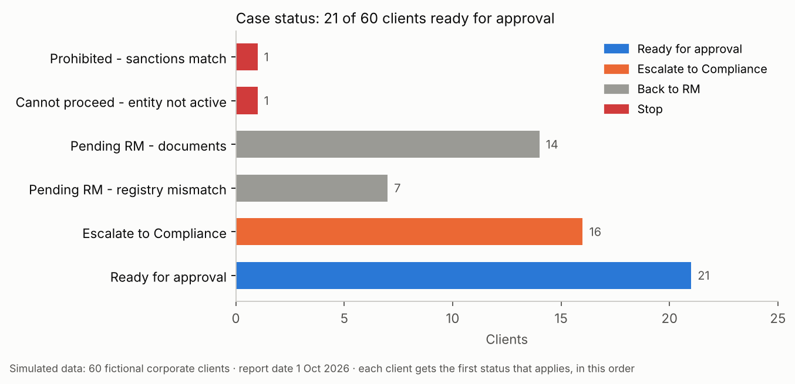
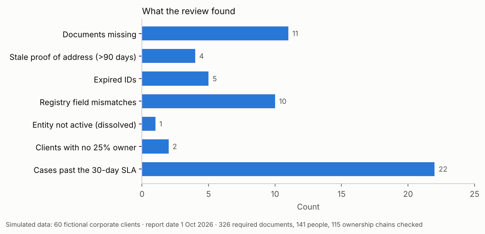
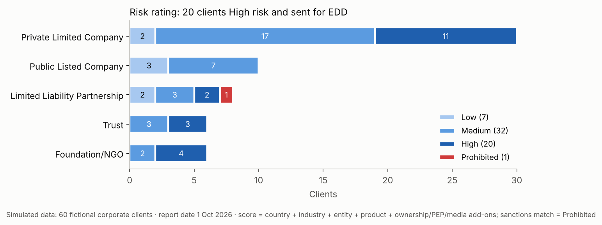
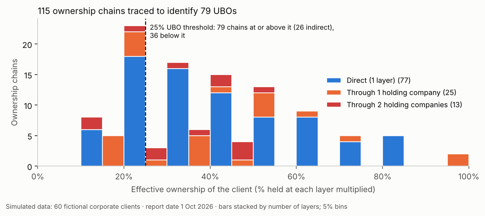
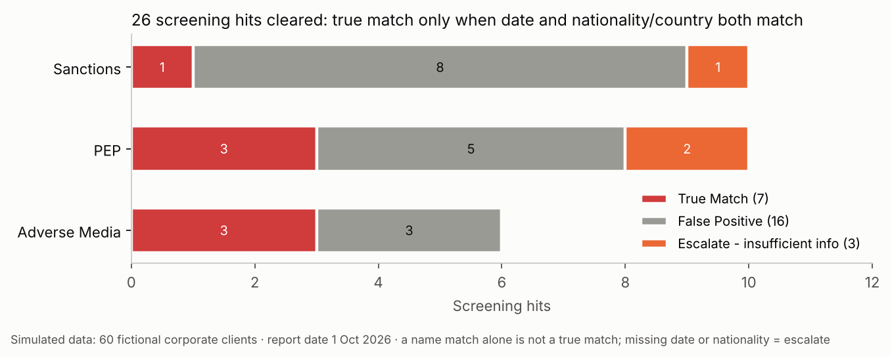

# Due Diligence Desk: KYC Record Review & Onboarding Tracker (Excel)

**60 corporate clients sent by Relationship Managers for KYC review. Which ones can be approved, which go back to the RM, which go to Compliance, and which must stop?**

A KYC review built in Excel: every client is checked against written standards (documents, IDs, registry record, beneficial owners, screening hits), given a risk rating, and routed to a case status, with an SLA tracker and a supervisor dashboard. Every rule sits in one `Ref_Rules` sheet, so a policy change updates every record.

> **Simulated data.** All companies, people, registry records and watchlist entries are fictional, created for practice. Country and industry risk levels are illustrative for this project only, not an official list.

## Key results (report date 1 Oct 2026)

| Area | Result |
| --- | --- |
| Documents | **326** required documents checked: **11** missing, **4** proofs of address older than 90 days |
| IDs | **141** people checked: **5** IDs expired |
| Registry | **10** fields differ from the RM's details; **1** client is dissolved |
| Ownership | **115** ownership chains traced: **79** UBOs at 25% or more, **26** of them held through holding companies; **2** clients have no 25% owner |
| Screening | **26** hits: **16** false positives, **7** true matches, **3** escalated for missing information |
| Risk | **20** clients High risk (EDD required), 32 Medium, 7 Low, 1 Prohibited (sanctions match) |
| Workflow | **21** ready for approval, 16 to Compliance, 21 back to the RM, 2 stopped; **22** cases past the 30-day SLA (average age 25.9 days) |

| What the review found | Risk rating by entity type |
| --- | --- |
|  |  |

| Ownership chains vs the 25% UBO line | Screening hits by list |
| --- | --- |
|  |  |

## How the review works

1. **Documents.** Required documents depend on the entity type (for example a Trust needs a Trust Deed and a list of trustees and beneficiaries), plus a PAN card copy for every India-incorporated client. A document is missing if not received, and a proof of address is stale if older than 90 days on the request date.
2. **IDs.** Each director, trustee and shareholder's ID is checked for expiry on the report date.
3. **Registry check.** The RM's details (internal source) are compared with the company registry extract (external source): name, registration number, address, incorporation date and status.
4. **Beneficial ownership.** Effective ownership = the % held at each layer multiplied. Example: a person owns 75% of a holding company that owns 70% of the client, so 52.5%. 25% or more = UBO. In `Ownership_Chains`, `L1_Pct` is the share of the client held by the owner directly above it.
5. **Screening.** A hit is a true match only when the date (birth or incorporation) and the nationality or country both match; missing information is escalated. A name match alone is not enough.
6. **Risk rating.** Score = country + industry + entity type + product, plus add-ons for 3+ ownership layers, a PEP match or adverse media. 4 or less = Low, 5–7 = Medium, 8+ = High. A sanctions true match makes the client Prohibited.
7. **Case status.** Each client gets the first status that applies: Prohibited → entity not active → pending RM (documents) → pending RM (registry mismatch) → escalate to Compliance (High risk, PEP or adverse media match, escalated hit, or no 25% owner) → ready for approval.
8. **Tracking.** Aging from the request date, SLA status (30 days), and a next review date by risk (High 12, Medium 24, Low 36 months).

## Limitations

- Simulated data, built to practise the review steps; real KYC uses more sources (firm websites, regulatory sites, screening tools).
- Screening uses only date and nationality/country; a real review also weighs other identifiers and the full list entry.
- Rules, scores and thresholds are illustrative, set in `Ref_Rules`, and would follow the bank's own standards.

## Files

| File | What it is |
| --- | --- |
| `Due_Diligence_Desk_KYC_Data.xlsx` | Raw inputs: client requests, registry extract, people, ownership chains, documents, screening hits, reference tables and rules |
| `Due_Diligence_Desk_Solved.xlsx` | The completed review with live formulas (green headers), Client_Review sheet and Dashboard |
| `charts.py` | Reads the completed review, re-checks key counts against the raw inputs, and draws the charts |
| `charts/` | Report charts |

**Excel skills used:** INDEX/MATCH lookups, COUNTIFS/COUNTIF, MAXIFS, nested IF with AND/OR, TRIM/UPPER for text matching, EDATE and date arithmetic for aging and review dates, and one structured rule sheet that drives every formula.

To redraw the charts: `pip install -r requirements.txt`, then `python charts.py`.

---
Author: **Salil Gokhale** · [LinkedIn](https://www.linkedin.com/in/salil-gokhale-analytics)
